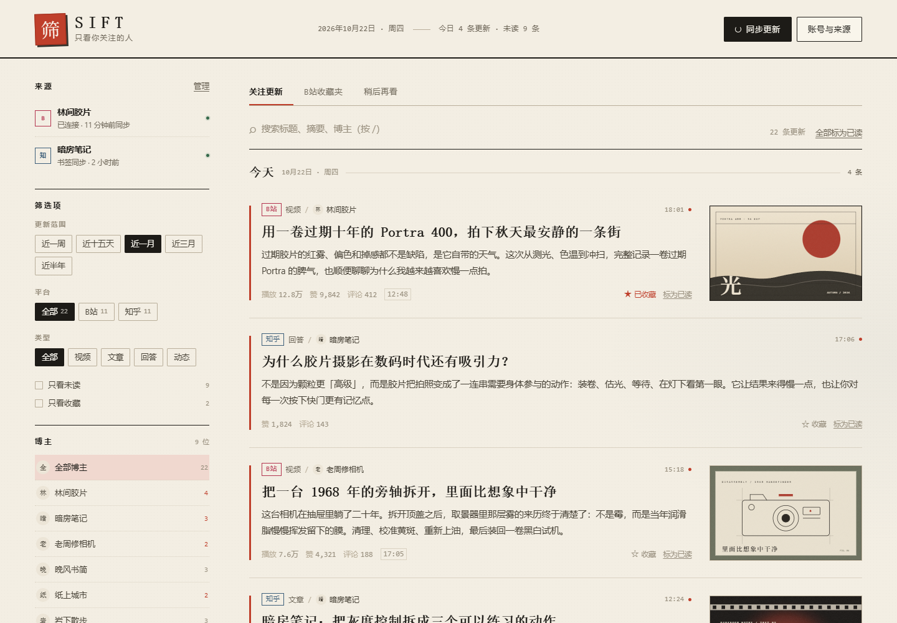

# 筛 SIFT

> 只看你关注的人。

把 B站 与知乎的关注更新收进一张纸：按时间范围、平台、类型、博主和关键词筛选，没有推荐算法，也没有广告位。所有数据只留在你自己的机器上。

**Windows 用户**：不想安装 Node，可直接下载 [SIFT.exe](https://github.com/Jiemanosh/sift/releases/latest) 双击运行，详见下方「Windows 一键版」。

[](LICENSE)
[](https://github.com/Jiemanosh/sift/releases/latest)




## 功能

- **关注更新聚合**：B站视频、动态、专栏，知乎回答、文章、想法。
- **可调时间范围**：近一周、近十五天、近一月、近三月、近半年。
- **精细筛选**：平台、内容类型、博主、只看未读、只看收藏、关键词搜索。
- **浏览位置记忆**：从某位博主返回「全部博主」时，回到上次停下的位置和已加载条数；右下角可一键回到顶部。
- **已保存内容**：浏览 B站收藏夹与稍后再看（只读，不会改动账号里的任何内容）。
- **手机只读端**：局域网扫码配对，访问码 + 签名 Cookie；可选 Android 壳应用。
- **本地优先**：JSON 存储、Cookie 与访问码只在本机，无遥测、无云端。

## 重要限制

SIFT 是给自己用的工具，不是公共网站：

- **桌面端完整权限只授予本机**（回环地址 `127.0.0.1`）。同一局域网的手机使用访问码，只能读取和标记已读/收藏，不能登录账号或触发同步。
- **不要直接暴露到公网，也不要放在公网反向代理后面。** 反向代理会让请求看起来来自本机，从而绕过访问码。远程使用请走 SSH 隧道或 VPN，详见[远程访问](#远程访问)。
- B站与知乎的接口都是非官方的，平台改版可能导致读取失败。
- 本项目与 B站、知乎无关联。请遵守平台条款，仅用于个人阅读；项目不提供任何点赞、关注、投币等写操作。

## 快速开始

需要 **Node.js 20+**（推荐 22 LTS），Windows / macOS / Linux 均可，无原生依赖。

```bash
git clone https://github.com/Jiemanosh/sift.git
cd sift
npm install
npm start
```

浏览器会打开 <http://127.0.0.1:8787>。Windows 也可以双击 `start.cmd`，macOS / Linux 可运行 `./start.sh`。

首次启动是空的信息流，按下面三步接入：

1. **B站**：右上角「账号与来源」→「扫码连接」，用手机 B站 扫码。登录态保存在本地，之后自动同步（默认每 20 分钟）。
2. **知乎**：在同一台电脑的 Chrome 中打开「账号与来源」→「同步书签」，把按钮拖到书签栏；登录知乎后点击该书签。书签会打开一个本机接收页，把关注列表与动态送进 SIFT。Chrome 155 起禁止公网页面直接访问回环地址，因此采用本地接收页转交。
3. 点右上角「同步更新」，开始浏览。

### Windows 一键版（EXE）

不想安装 Node，可以直接从 [Releases](https://github.com/Jiemanosh/sift/releases/latest) 下载 `SIFT.exe`，双击运行。单文件约 35 MB，已内置 Node 运行时，支持 Windows 10 / 11 x64。

- **首次启动**会先解压运行文件，并弹出 Windows 防火墙询问。只在电脑上使用可以点「取消」；需要用手机访问同一局域网时点「允许」（勾选专用网络即可）。
- EXE 未做代码签名，SmartScreen 可能显示「未知发布者」。可选择「更多信息 → 仍要运行」，并用 Release 中的 `SIFT.exe.sha256` 校验文件。
- 启动后常驻系统托盘：双击图标重新打开页面；右键可打开数据文件夹、查看日志或退出。
- 数据保存在 `%LOCALAPPDATA%\SIFT\data`，日志在 `%LOCALAPPDATA%\SIFT\logs\sift.log`。升级时直接替换 EXE 即可，数据不受影响。
- 默认端口 8787；被占用时会自动尝试 8787–8887，实际端口写在 `%LOCALAPPDATA%\SIFT\port.txt`。
- 退出：右键托盘图标 →「退出」，或运行 `SIFT.exe --stop`。彻底清除请先退出，再删除 `%LOCALAPPDATA%\SIFT`。
- 想放到其他目录或 U 盘：设置 `SIFT_HOME` 后再启动，例如 `set SIFT_HOME=D:\SIFT`；`SIFT_PORT` 同样生效。
- 自行构建：`powershell -ExecutionPolicy Bypass -File windows/build.ps1`（需要 Node.js 20+ x64），产物为 `windows/dist/SIFT.exe`。

### 演示数据

想先看看界面，可以只用虚构数据启动第二个实例：

```bash
SIFT_DATA_DIR=.tmp/demo npm run seed:demo
SIFT_DATA_DIR=.tmp/demo SIFT_PORT=8788 SIFT_NO_SYNC=1 npm run serve
```

打开 <http://127.0.0.1:8788>，不会碰到 `data/` 里的真实登录态。

## 配置

原生运行使用环境变量；Docker Compose 会自动读取项目根目录的 `.env`（可从 [.env.example](.env.example) 复制）。

| 变量 | 默认值 | 说明 |
| --- | --- | --- |
| `SIFT_PORT` | `8787` | 监听端口，也接受 `PORT` |
| `SIFT_HOST` | `0.0.0.0` | 监听地址。设为 `127.0.0.1` 可完全关闭局域网访问 |
| `SIFT_DATA_DIR` | `./data` | 数据目录，保存 `state.json`、`sessions.json`、`config.json` |
| `SIFT_ORIGIN` | `http://127.0.0.1:<端口>` | 知乎同步书签使用的本机地址 |
| `SIFT_ALLOWED_HOSTS` | 空 | 额外允许的主机名，逗号分隔；仅用于局域网自定义域名 |
| `SIFT_SYNC_MS` | `1200000` | B站自动同步间隔（毫秒） |
| `SIFT_NO_SYNC` | 空 | 设为 `1` 关闭自动同步 |
| `SIFT_BILI_DAYS` / `SIFT_ZHIHU_DAYS` | `180` | 内容保留天数 |
| `SIFT_MAX_ITEMS` | `1500` | 最多保留条目数 |

示例：

```bash
SIFT_PORT=9000 SIFT_HOST=127.0.0.1 npm start
```

## 部署

### Linux / NAS 长期运行

用 systemd 托管（把路径和用户换成你的）：

```ini
[Unit]
Description=SIFT feed filter
After=network-online.target
Wants=network-online.target

[Service]
Type=simple
User=sift
WorkingDirectory=/opt/sift
ExecStart=/usr/bin/node --dns-result-order=ipv4first server/index.js
Environment=SIFT_PORT=8787
Environment=SIFT_SYNC_MS=1200000
Restart=always
RestartSec=3

[Install]
WantedBy=multi-user.target
```

```bash
sudo systemctl daemon-reload
sudo systemctl enable --now sift
```

不想写 unit 文件也可以用 `pm2 start npm --name sift -- run serve`。

### Docker

仓库包含 [Dockerfile](Dockerfile) 与 [docker-compose.yml](docker-compose.yml)：

```bash
cp .env.example .env   # 可选，按需修改
docker compose up -d --build
docker compose logs -f
```

- 数据保存在命名卷 `sift-data`（容器内 `/data`），重建容器不会丢登录态。
- Compose 默认使用 `network_mode: host`（Linux / 多数 NAS）。这样从宿主机浏览器访问 `127.0.0.1:8787` 时仍是完整权限，配对码、扫码登录也正常。
- **Docker Desktop（Windows / macOS）的 host 网络支持因版本而异。** 若不可用，请改用原生 Node 运行；桥接网络下宿主机访问会被当作局域网设备，只能只读浏览且看不到配对码，不适合首次配置。

备份数据卷：

```bash
docker run --rm -v sift_sift-data:/data -v "$PWD":/backup alpine \
  tar czf /backup/sift-data.tgz -C /data .
```

### 远程访问

出门在外想用家里电脑上的 SIFT，推荐这两种方式：

1. **SSH 隧道（推荐，完整权限）**

   ```bash
   ssh -L 8787:127.0.0.1:8787 你的用户名@家里电脑
   ```

   然后在本地打开 <http://127.0.0.1:8787>。流量全程加密，服务端看到的是回环连接。

2. **Tailscale / WireGuard（手机只读）**

   把设备的 Tailscale 主机名加入 `SIFT_ALLOWED_HOSTS`，手机通过局域网地址访问并输入访问码。仍是只读端。

**不要**把端口直接映射到公网，也**不要**配置公网域名反向代理。

## 手机与 Android

- **手机网页端**：「账号与来源 → 手机 App」展示配对二维码与访问码。手机需与电脑在同一局域网；扫码后获得 30 天只读会话。手机端可以筛选、搜索、收藏、标已读，不能登录或同步。
- **Android 壳应用（可选）**：一个只承载网页的 WebView 壳，启动时填写电脑地址与访问码，行为与手机网页端一致（只读）。APK 未包含在仓库中，可按需自行构建：

  ```bash
  ANDROID_SDK_ROOT=/path/to/android-sdk ./android/build.sh
  # 产物：android/sift.apk
  ```

  需要 JDK、Android SDK（API 35）与构建工具；签名密钥在 `android/keystore/` 本地生成并被 Git 忽略。

## 数据与隐私

- `data/`（或 `SIFT_DATA_DIR`）中的 JSON 包含登录 Cookie、访问码与会话签名密钥。**不要提交、不要分享该目录**；`data/` 已在 `.gitignore` 中。
- Windows EXE 的默认数据目录是 `%LOCALAPPDATA%\SIFT\data`；删除整个 `%LOCALAPPDATA%\SIFT` 会连同登录态一起清除。
- 对外的网络请求只发往 B站 / 知乎的 API 与图片域名；图片代理只允许 `bilibili.com`、`hdslb.com`、`zhihu.com`、`zhimg.com`。
- 没有统计、埋点或第三方脚本。
- B站收藏夹与稍后再看为只读浏览；不提供收藏、点赞、关注等写操作。

## 开发

```bash
npm test       # 单元测试（node:test）
npm run smoke  # 可选：UI 冒烟测试，需要本机 Chrome/Chromium
```

UI 冒烟测试会启动浏览器并生成截图：

```bash
SIFT_DATA_DIR=.tmp/demo npm run seed:demo
SIFT_DATA_DIR=.tmp/demo SIFT_PORT=8788 SIFT_NO_SYNC=1 npm run serve
SMOKE_URL=http://127.0.0.1:8788/ CHROME_PATH="/path/to/chrome" npm run smoke
```

`CHROME_PATH` 未设置时使用 Windows 默认的 Chrome 路径。

目录结构：

```
server/   Express API、B站/知乎读取、同步、存储与手机鉴权
public/   原生 HTML/CSS/JS 前端（无构建步骤）
windows/  Windows 单文件启动器（C# + 内嵌 Node 运行时）
android/  可选的 Android WebView 壳
scripts/  演示数据与 UI 冒烟测试
test/     node:test 单元测试
```

服务端启动统一使用 `--dns-result-order=ipv4first`，以规避部分网络下知乎域名 IPv6 超时的问题。

## 常见问题

**知乎总是读不出来？**
先在 Chrome 里登录知乎，再点击已安装的「同步书签」；确认书签不是旧版本（重新从「账号与来源」拖一次）。如果直接请求知乎超时，通常是本地网络的 IPv6 问题，项目已默认优先 IPv4。

**重启后要重新登录？**
登录态保存在数据目录中，只要 `SIFT_DATA_DIR` 不变就会保留。B站 Cookie 可能因平台策略过期，需要重新扫码。使用 Docker 时请确认数据卷仍然挂载。

**端口被占用？**
`SIFT_PORT=8788 npm start` 换一个端口即可。

**手机打不开？**
确认手机与电脑在同一 Wi-Fi、系统防火墙允许 Node 或 `SIFT.exe` 监听端口、路由器未开启 AP 隔离；访问地址必须是电脑的局域网 IP，并输入访问码。使用 EXE 时，首次启动要允许防火墙的「专用网络」访问。

**EXE 双击后没反应？**
先看托盘区是否有 SIFT 图标（可能被折叠），再查看 `%LOCALAPPDATA%\SIFT\logs\sift.log` 和 `port.txt`。如果浏览器没自动打开，手动访问日志里显示的地址即可。

**能部署成公开网站给朋友用吗？**
不建议。SIFT 的权限模型以「本机 = 所有者」为前提，没有多用户账号体系。请每位使用者各自部署一份。

## 参与贡献

欢迎 Issue 与 PR。提交前请运行 `npm test`；涉及界面的改动建议同时跑一遍 UI 冒烟测试并附上截图。

## 许可证

[MIT](LICENSE) © 2026 Jiemanosh

B站、知乎及相关内容的版权归各自权利人所有；本项目只做个人阅读用途的聚合展示。
